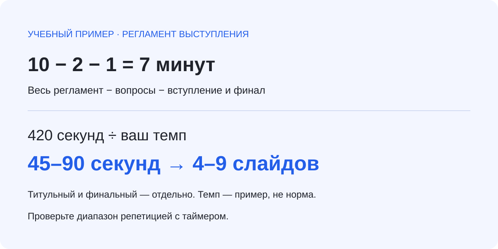

# Проверка данных и регламента презентации

Presentation data and talk-timing checks: учебные данные, ожидаемые ответы и короткие чек-листы для тех, кто готовит доклад или отчёт. Ресурс подготовлен для [YaSlide](https://yaslide.ru/about); связь с продуктом раскрываем прямо. Текст подготовлен с помощью ИИ, числовые ответы проверены вычислениями. Все примеры учебные.

## 1. Сверьте числа до оформления

В [report-example.csv](data/report-example.csv) три периода: 120, 150 и 180 тысяч рублей. Проверяемые ответы:

| Проверка | Расчёт | Ответ |
|---|---|---|
| Сумма | 120 + 150 + 180 | 450 тыс. ₽ |
| Рост между первым и третьим периодом | (180 − 120) / 120 × 100 | 50% |
| Изменение доли с 20% до 30% | 30 − 20 | 10 процентных пунктов |
| Относительный рост той же доли | (30 − 20) / 20 × 100 | 50% |
| Общая доля двух групп: 64/80 и 27/30 | (64 + 27) / (80 + 30) × 100 | ≈82,73% |

Среднее двух групповых процентов (80% и 90%) равно 85%, но группы разного размера. Для общей доли нужен общий числитель и знаменатель. Сравнивайте один период, единицы и состав выборки. При нулевой базе относительный рост в процентах не определён.

Перед показом проверьте:

- Каждый итог совпадает с исходными строками.
- Проценты и процентные пункты подписаны раздельно.
- У каждой доли указан знаменатель.
- Учебные данные не названы результатами клиентов.
- Цель, прогноз и факт различаются в заголовке и подписи.

Более подробный собственный разбор: [проверка чисел в презентации](https://yaslide.ru/blog/proverka-chisel-v-prezentacii).

## 2. Рассчитайте число слайдов под свой темп



Формула при времени в минутах:

```text
T = max(0, (общее время − вопросы − вступление и финал) × 60)
fast = min(два значения секунд на слайд)
slow = max(два значения секунд на слайд)
нижняя граница = floor(T / slow)
верхняя граница = floor(T / fast)
```

Для регламента 10 минут, вопросов 2 минуты и служебных блоков 1 минута остаётся 420 секунд. При выбранном темпе 45–90 секунд получается 4–9 содержательных слайдов. Время титульного и финального блоков уже вычтено; их слайды считайте отдельно.

45–90 секунд — демонстрационная настройка, а не научная норма темпа. Проговорите два собственных слайда с таймером и подставьте свои значения. При нижней границе 0 даже один сложный слайд может не помещаться; при верхней 0 нужно менять регламент или содержание.

[Готовые граничные примеры](data/talk-timing-cases.csv) включают нормальный и обратный темп, дробные минуты и отсутствие времени. Пустые, бесконечные, отрицательные значения и нулевой темп должны отклоняться до деления.

Проверить свой сценарий можно в [бесплатном калькуляторе YaSlide](https://yaslide.ru/instrumenty/raschet-vystupleniya). Для этого отдельного инструмента не нужны вход, загрузка документа или LLM API; введённые значения вычисляются в браузере. Возможности создания презентаций и права экспорта описаны отдельно на сайте продукта.

## 3. Проверьте файл получателя

1. Дождитесь сохранения правок.
2. Откройте итоговый PDF/PPTX, который собираетесь передать.
3. Сверьте заголовки, крупные числа, единицы и оговорки.
4. Проведите репетицию именно с этим файлом и таймером.

## English summary

This resource provides synthetic presentation data, expected numerical answers and talk-timing boundary cases. It is affiliated with YaSlide. It does not contain customer data or the application's source code. AI assistance was used to prepare the text; numerical examples were independently calculated. The timing range uses the speaker's own pace and is an estimate, not a speaking-speed standard.

Updated: 15 October 2026. Corrections and reproducible examples are welcome in Issues.
